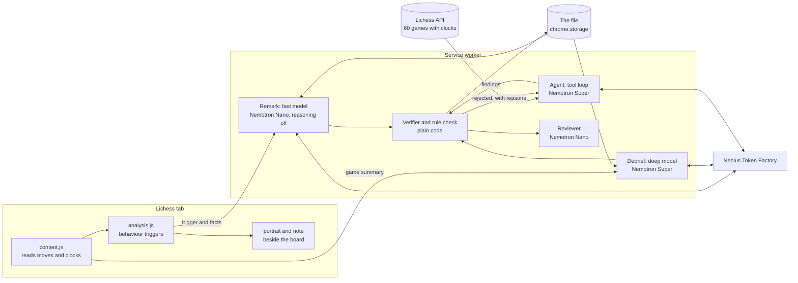

# Hannibal

**A coach for your chess mind, not your moves.**

Hannibal is a Chrome extension for [Lichess](https://lichess.org). Three characters watch *how* you play: when you rush, when you freeze, how you spend your clock and how you take a loss. They speak to you during games against the computer and debrief you after every game. They never look at the position and never suggest a move.

It runs on **NVIDIA Nemotron** models served by **Nebius Token Factory**. An agent reads your Lichess history with tools, and a verifier checks every claim it makes against the data.


*Illustration: the images in this README come from a test page that imitates Lichess, and the character lines in them were written by the developer to show the layout. Real Nemotron output appears in the demo video.*

**Try it in 2 minutes:** unzip, load it as an unpacked extension (see Install), and click **Show a sample file first** on the settings page. No key and no games are needed. To see it work on real data, paste a Nebius key and enter any Lichess username with at least 20 timed games.

## Why it exists

Most chess improvement tools tell you the best move. Lichess bans extensions that help you play, and for good reason. Most club players don't lose because they can't find the move, though. They lose because they rush after a blunder, burn the clock early or keep playing tilted at 1am. Engines don't see any of that. Hannibal sees only that.

| | Engine tools | Hannibal |
|---|---|---|
| Looks at | the position | your behaviour: time, haste, hesitation, habits |
| Tells you | the best move | what you did, in numbers, in a character's voice |
| During rated games | not allowed | silent; debrief only |
| Remembers you | no | a file that grows with every game |

## The three


- **The General.** Hannibal Barca: the clock as supplies, the opening as the march over the Alps, finishing what you start. *Flaw: mistakes caution for cowardice.*
- **Dr. Vale.** A clinician of decisions. Watches hesitation, haste and the patterns you repeat. *Flaw: sees symptoms in noise.*
- **Ashby.** A steward whose household is gone. Watches you: streaks, tilt, the late hour. *Flaw: softens hard truths until it is nearly too late.*

Each has a written character bible, a voice, a flaw and backstory that unlocks as rapport grows (stranger after 0 games, acquainted after 5, trusted after 12). Each prompt also carries a few lines to sound like and a few never to sound like. They disagree with each other.

## How it works



1. **Watching (no model).** `content.js` reads each move and the clocks from the page and replays the moves with chess.js for exact material. `analysis.js` fires behaviour triggers:
   - **rush after loss:** you lost material (net of recaptures), then made two fast replies.
   - **hesitation:** a think far above your own norm for this time control.
   - **haste before a loss** (after the game, and in the file): how long you thought on your own move right before the opponent won material, against your usual think. At beginner level most material is lost right after a hurried move; this shows whether that is you, in seconds. It times the move and never says whether the move was good.
   - **clock burn:** most of the clock gone by move 20.
   - **left book:** you left known theory yourself.
   - **session start:** a losing streak, or late at night.

   Thresholds scale with the time control and with your own pace.
2. **Remarks (fast model).** A trigger becomes a short line from the character it belongs to, via a small Nemotron with reasoning turned off so it lands before your next move. Under it is the number that caused it ("Noted: 63s on 10…f5, against a usual 5.0s").
3. **Debrief (deep model).** After the game a larger Nemotron writes three lines, one per character, grounded in the game's facts and your file.
4. **The file (agent).** "Read my games" fetches up to 60 recent games with per-move clocks. A Nemotron agent investigates them with tools (`get_overview`, `get_stats`, `compare`, `list_games`) and submits findings with `finish`.
5. **The verifier (code, not prompt).** Every finding names a metric and a group of games. The verifier recomputes it from the data and writes the evidence itself:
   - A contrast must differ from the other games (of the same speed) by at least 25%, or 15 points, with at least 3 games on each side, and pass a permutation test (p ≤ 0.05).
   - A trait needs 5 games.
   - Think times are only compared within one speed.

   Any number written in a finding, a first impression, a debrief or a live remark must appear in the facts the model was given, allowing for rounding. Otherwise the line is rejected.

   Rejected findings go back to the agent with the reason, for up to 2 revisions. A rule check also blocks any remark, debrief line or finding that gives an instruction or judges the position. A live remark that fails is never shown; a debrief gets one corrective retry. Every call to Nebius has a timeout (15 s for live, 90 s for deep), so a slow model never freezes the page.

   Debrief lines, first impressions and live remarks that pass the code checks then go to a second gate. Nemotron Nano, at temperature 0, reads each line and flags advice phrased as a question, judgements of the position, or empty filler. Flagged debrief lines are rewritten once and dropped if they fail again; flagged live remarks are just not shown. If the reviewer can't be reached, the code checks still stand.
6. **The trend.** Once you have played 3 games after the file was opened, it shows what changed: for example, games with a rush after losing material went from 50% to 25%.

Native OpenAI-style tool calls are used when the model accepts them. If the API rejects the tools parameter, the agent switches to a JSON tool protocol that works with any chat model. Rate limits are retried. A bad key is reported as a bad key.

## Results

These are checks on the verifier itself, not proof that players get insight (that needs real users). From the offline evaluation (`npm run eval`, seeded, 1,000 synthetic players per cell, no API calls; full tables in [docs/EVAL.md](docs/EVAL.md)). Rates are per single test; the agent may test several metrics per file:

| Planted effect in lost games | Detected at 20 games | at 60 games | False positives |
|---|---|---|---|
| Rushing after material loss, 60% vs 20% | 31% | 91% | ≤ 3% |
| Pace after material loss, 0.55x vs 1.0x | 95% | 100% | ≤ 4% |
| Pace on the move before a loss, 0.5x vs 0.9x | 76% | 100% | ≤ 5% |
| Clock gone by move 20, 50% vs 15% | 25% | 80% | ≤ 3% |

- Think times compared across time controls were rejected in all 2,000 attempts.
- The code rule check blocked all 20 advice lines and passed all 20 in-character observations in a hand-labelled set. The set was written by the same author as the rules, so treat that as a sanity check, not a benchmark.
- With a short history (around 10 games) the verifier mostly refuses to report a pattern. That is intended: there is too little evidence.

Response times on Nebius are measured per call and shown on the settings page.

## Fair play

Lichess's fair-play rules forbid assistance during games. Hannibal is designed to give none:

- It never receives the position as anything but a move list, and no engine is involved.
- The models are told never to evaluate the position or suggest moves, and code enforces it. Lines containing instructions ("you should", "castle", "keep your…") or position judgements ("blunder", "advantage", "best move") are dropped.
- By default it speaks during a game only against the computer or bots. In rated games against people it stays silent until the game is over.

## Install

1. Download this repository as a ZIP and unzip it.
2. Open `chrome://extensions`, turn on **Developer mode** and click **Load unpacked**. Choose the folder that contains `manifest.json`.
3. The settings page opens. Click **Show a sample file first** to see what the characters write without a key.
4. Paste a Nebius Token Factory key, click **Load my Nemotron models**, check the fast and deep model and click **Save settings**.
5. Enter your Lichess username and click **Read my games**. Watch the agent and the verifier work.
6. Play a timed game against the computer on lichess.org.

## Tests

```
npm test
```

There are no dependencies to install. The tests cover the behaviour triggers, trades not counting as losses, pace scaling by time control, import of two real Lichess games, the agent loop against a mocked API (native tools, JSON fallback, verifier revisions, rate limits, bad key) and the rule check.

## Built with

- NVIDIA Nemotron: Nemotron 3 Nano for live remarks and as the reviewer, Nemotron 3 Super for debriefs and the agent.
- Nebius Token Factory (OpenAI-compatible API).
- Chrome Manifest V3, plain JavaScript, no build step.
- The Lichess public API, the lichess chess-openings database (CC0), and chess.js (BSD-2-Clause).
- EB Garamond (OFL) and Special Elite (Apache 2.0).

## Files

| File | What it does |
|---|---|
| `content.js` | Watches the game, decides when to speak, draws the note beside the board, makes the share card |
| `analysis.js` | Behaviour triggers, game summaries, Lichess import, aggregates, trend |
| `background.js` | Characters, prompts, model routing, rule check, API calls |
| `agent.js` | Onboarding agent, tools, verifier |
| `portraits.js` | The three portraits, drawn as SVG |
| `options.html` / `options.js` | The settings page, laid out as a case file |
